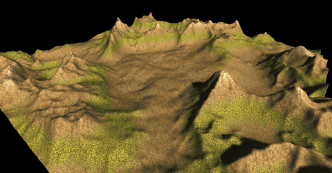
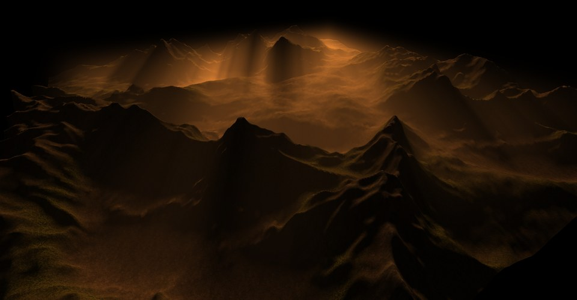

# Multitexture Terrain Rendering

Using heightmaps, libnoise for heightmap generation

Write-up: https://jose-villegas.github.io/post/terrain/

## Features

- Heightmaps generated with libnoise, textured by height with four blended texture ranges.
- Time of the day lighting from path-traced lightmaps: soft sun shadows, sky light and two diffuse bounces, baked on the CPU for 384 times of the day (about 9 seconds for 512x512 lightmaps on 32 threads).
- Light shafts (Rendering Options, off by default): a post pass marches each view ray through a height fog over the terrain, lit only where the terrain does not block the sun, then blurs it at half resolution and adds it tinted by the sun color. Most visible looking towards a low sun.
- Geomipmapping: the mesh is split in chunks, each drawn at the coarsest level whose screen-space error stays under a pixel threshold, with the borders stitched to coarser neighbours so the mesh stays watertight.

## Building

Open `HeightmapRenderer.sln` in Visual Studio 2026 and build the `Debug` or `Release` configuration for `Win32`. The dependencies (GLFW, GLEW, GLM, OGLplus, FreeImage, libnoise and ImGui) are included under `HeightmapRenderer/`.

## Running

Run `HeightmapRenderer.exe` with `HeightmapRenderer/` as the working directory, the shaders and textures load from relative paths. `F` toggles the free camera (mouse to look, `WASD` to move, `Q`/`E` to change speed), the mouse wheel zooms and `Esc` quits.

`--capture <dir>` renders the orbit above instead, with the screenshot's terrain and textures, and saves every frame to `<dir>` as PNG, then exits. The GIF was assembled from those frames with ffmpeg. With `--light-shafts` the app starts with the light shafts on, and the capture sweeps the sunset without the wireframe:

