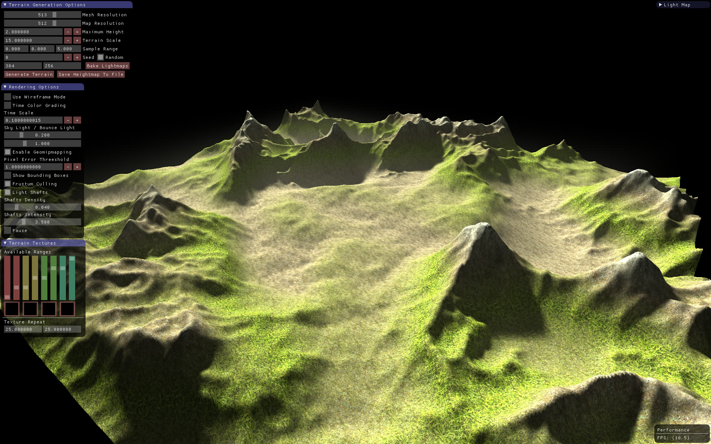

# Multitexture Terrain Rendering

Heightmap terrain generated with libnoise, OpenGL.

- Terrain textured by height, four blended ranges.
- Time of the day lighting from path-traced lightmaps.
- [Light shafts](images/light-shafts.jpg) through a height fog.
- [Geomipmapping](docs/geomipmapping.md): level of detail chunks, stitched at their borders.

Write-up: https://jose-villegas.github.io/post/terrain/

## Build and run

Open `HeightmapRenderer.sln` in Visual Studio 2026 and build `Win32` `Debug` or `Release`. Run with `HeightmapRenderer/` as the working directory.

`F` toggles the free camera (mouse, `WASD`, `Q`/`E` for speed). `--capture <dir>` saves the GIF's frames as PNG.
