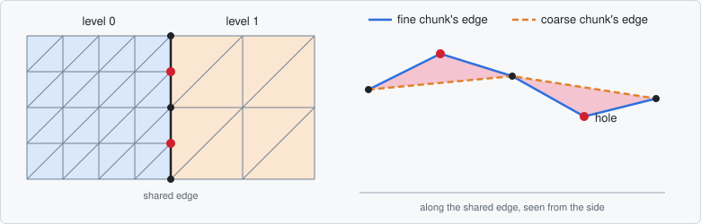
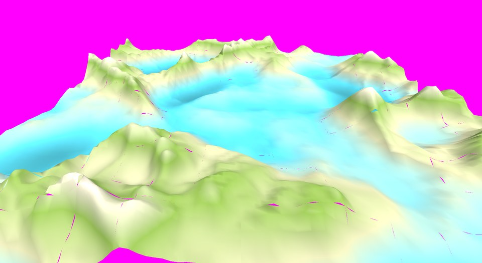
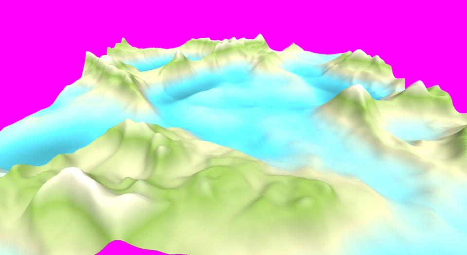
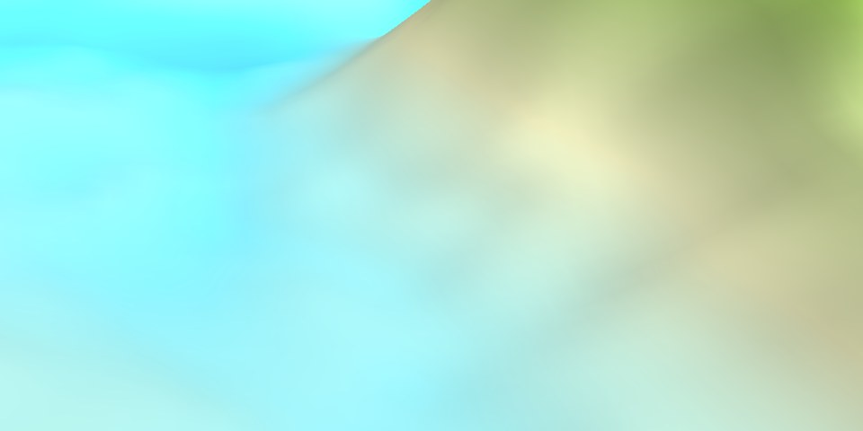
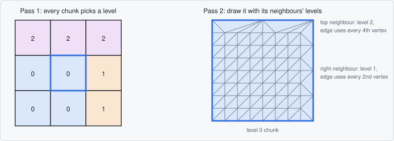
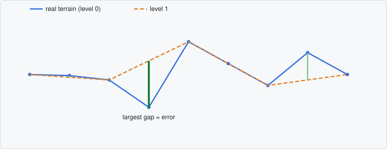
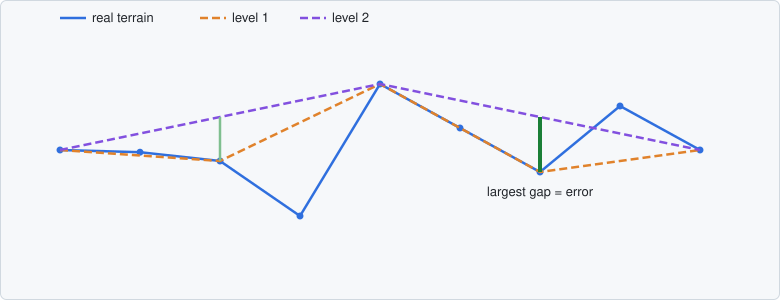
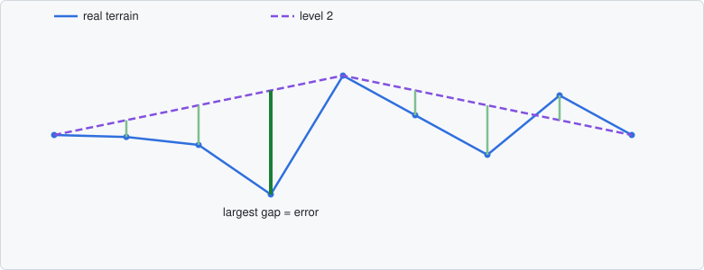
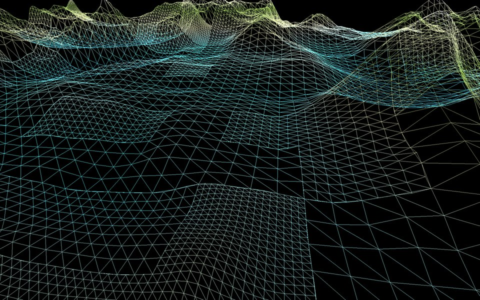
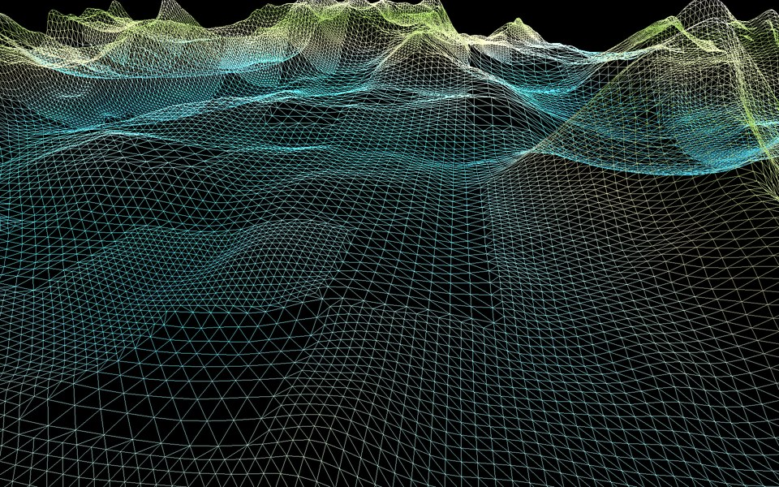

# Geomipmapping: what was broken and how it was fixed

There were two separate bugs. The chunks did not fit together at their borders, so the terrain had cracks. And each chunk measured its own error wrongly, so it picked the wrong level of detail.

## The idea in one picture

The terrain is cut into square chunks. Each chunk can be drawn with every vertex (level 0), every 2nd vertex (level 1) or every 4th vertex (level 2). Chunks far from the camera use fewer triangles, because the detail they lose is too small to see on screen.

*Each square is a chunk, and the lines inside show how many triangles it uses. Level 0 is near the camera, levels 1 and 2 are further away.*

## Bug 1: cracks where two levels meet

Look at the border between a level 0 chunk and a level 1 chunk. The fine chunk has a vertex in the middle of the edge. The coarse chunk does not, so it draws a straight line over that spot.

*Left, from above: the fine chunk's middle vertices (red) sit on the coarse chunk's edge, but the coarse chunk does not use them. Right, the same edge seen from the side: the fine chunk follows the real height at the red vertex, while the coarse chunk cuts straight across. The sliver between the two lines is a hole you can see through.*

### In the renderer

These are the same camera in the app before and after the fix, with the background set to magenta. Anything magenta on the terrain is a hole. The renders come from the commit just before the fix and from the fix itself, with a pixel threshold of 3.

| Before | After |
| --- | --- |
|  |  |
|  |  |

Each sliver runs along a border between two chunks drawn at different levels.

### The fix: the finer chunk gives in at the border

Along an edge shared with a coarser neighbour, the finer chunk skips the extra vertices and connects its triangles to the coarse vertices instead. Both chunks then draw exactly the same straight edge, so there is nothing to see through.

*Left, from above: the fine chunk's border triangles now fan into the coarse vertices, and the red vertices are no longer used. Right, from the side: the fine chunk's edge now lies on the coarse line, so the gap is gone.*

This means a chunk's triangles depend on its four neighbours, so two things changed:

- **A set of triangles for each neighbour combination.** The triangles are built once at start-up for every combination of the chunk's own level and the levels of its top, left, bottom and right neighbours, where each neighbour is the same level or coarser. That makes 98 sets in total, and the right one is picked when drawing.
- **Two passes when drawing.** First every chunk picks its level. Then every chunk is drawn with the set that matches its neighbours. In a single pass, a chunk could be drawn before its neighbour had decided its level.

*Pass 1 decides every chunk's level. Pass 2 draws the middle chunk (level 0) with its right neighbour at level 1 and its top neighbour at level 2, so its right and top edges are stitched to those spacings.*

## Bug 2: measuring how much detail is lost

A chunk should use the coarsest level that still looks right. To decide, each chunk measures once how far each simplified level strays from the real terrain. That distance is the level's **error**, and it is a height. While drawing, the error is turned into pixels for the current camera distance, and the chunk takes the coarsest level whose error stays under a pixel threshold.

*The blue line is the real terrain along a row of a chunk, and the orange line is the level 1 version, which keeps every 2nd vertex. The error of level 1 is the largest vertical gap between them (green). The old code looked at a single gap only, here the first one, which happens to be small.*

The old measurement had three mistakes:

1. **One sample instead of all of them.** The loop over all the dropped vertices compared sample number `i`, which is the level (0 or 1), instead of sample `j`. So level 1 only ever looked at the first dropped vertex, and level 2 only at the second.
2. **Compared with the previous level, not with the real terrain.** Level 2 was measured against level 1. The detail that level 1 had already dropped was never counted, so the errors did not add up as the mesh got coarser.
3. **Height scale ignored.** The error was measured on the unscaled heights, but the terrain is drawn stretched upwards. So every error looks bigger on screen than it was measured.

**Old:** level 2 measured against level 1

**New:** level 2 measured against the real terrain

*Level 2 keeps every 4th vertex (purple). Measured against level 1 (orange, the old way), the gaps look small. Measured against the real terrain (blue, the new way), the largest gap is much bigger. The errors now also only grow from one level to the next.*

With errors that small, every chunk believed it could drop to its coarsest level almost anywhere. That made the cracks from bug 1 even more common.

### The rule that picks the level

On screen, an error shrinks with distance. A chunk switches to a coarser level once the camera is far enough away that the level's error would cover fewer pixels than the threshold:

`distance² > C² · (error · heightScale)²`

`C` comes from the screen height, the field of view and the pixel threshold.

*This chart shows the error of each level in pixels as the camera moves away. Each level is allowed once its curve drops under the threshold (dashed), so the chunk goes from level 0 to 1 to 2 as it gets further away.*

### In the renderer

These are wireframes from the same camera. Before the fix, chunks right in front of the camera dropped to big coarse triangles, while some far chunks stayed fine. After the fix, the detail falls off with distance, and flat areas simplify first.

| Before | After |
| --- | --- |
|  |  |

> With honest errors, the default threshold of 0.35 pixels keeps nearly every chunk at full detail, which is what a threshold under one pixel means. The capture uses 3 pixels so that the changes of level show up in the wireframe.

The code is split across three files. The stitched triangle sets are in [`ChunkDetailLevel.cpp`](../HeightmapRenderer/ChunkDetailLevel.cpp), the error and the level choice are in [`TerrainChunk.cpp`](../HeightmapRenderer/TerrainChunk.cpp), and the two passes are in [`TerrainChunksGenerator.cpp`](../HeightmapRenderer/TerrainChunksGenerator.cpp).
