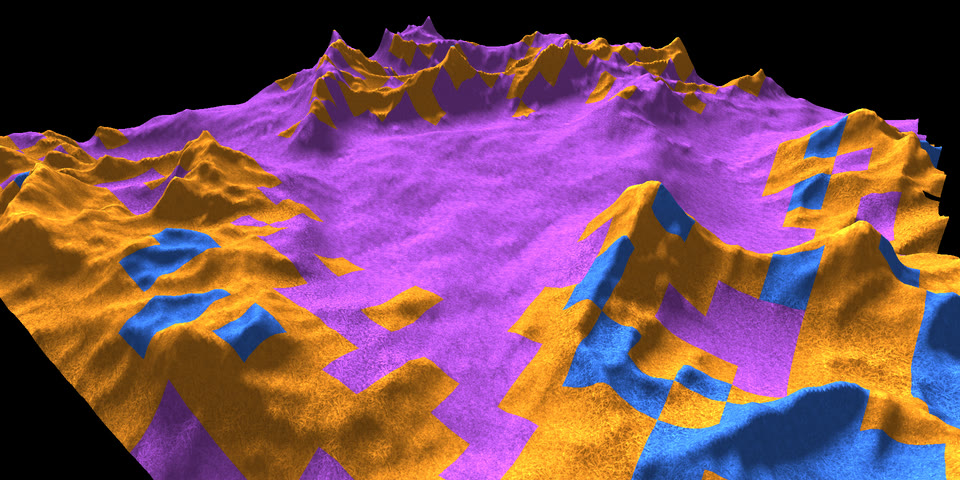
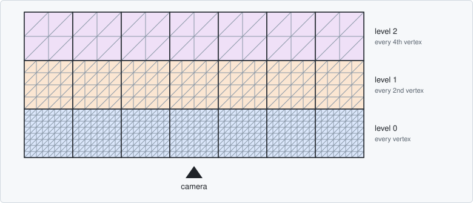
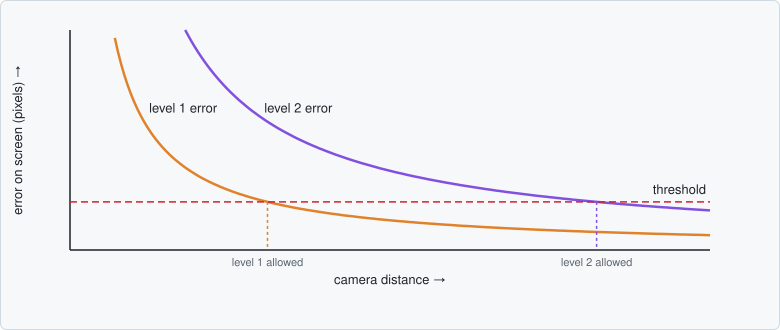
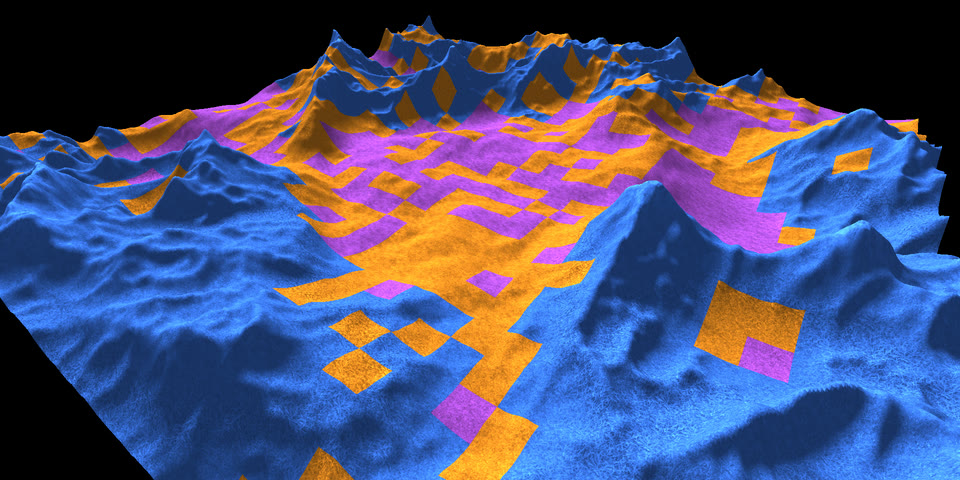
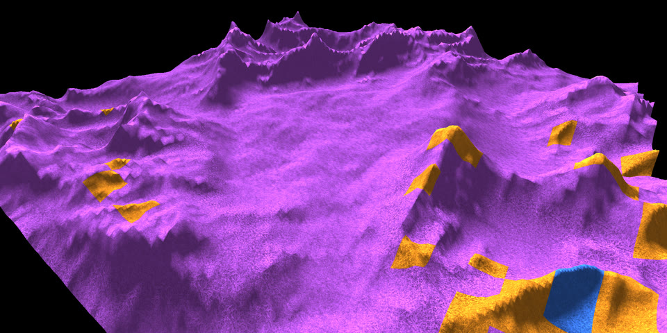
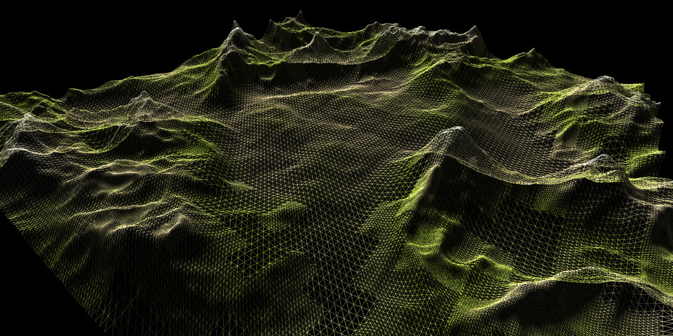
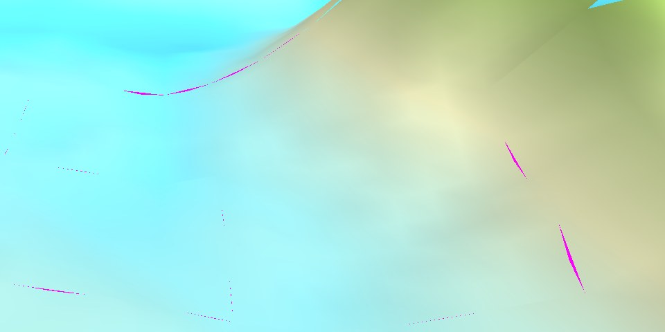
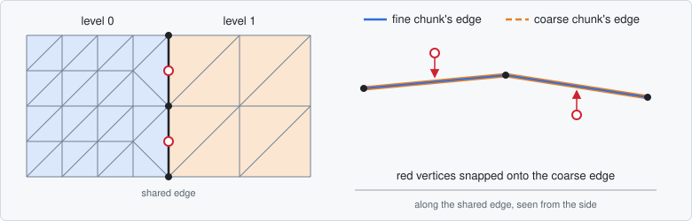
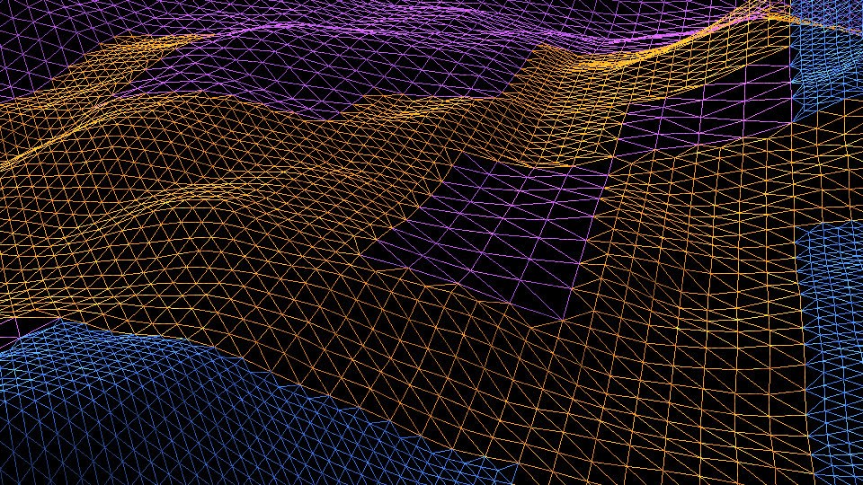

# Geomipmapping

The README terrain is a 513 × 513 vertex mesh, about half a million triangles. Up close that detail matters; a kilometre away, most of those triangles are smaller than a pixel. Geomipmapping (de Boer, 2000) draws each part of the terrain with only as many triangles as it needs. It works like texture mipmaps, but for geometry.



*Chunks tinted by level: blue 0 (full detail), orange 1, purple 2.*

## 1. Chunks and levels

The mesh is cut into square chunks of 17 × 17 vertices, so 32 × 32 chunks for the README terrain. Each chunk is stored at three levels:

| Level | Keeps | Vertices | Triangles |
| --- | --- | --- | --- |
| 0 | every vertex | 17 × 17 | 512 |
| 1 | every 2nd vertex | 9 × 9 | 128 |
| 2 | every 4th vertex | 5 × 5 | 32 |



Every frame, each chunk picks one level. The vertex data never changes; a level is just a different index buffer over the same vertices.

## 2. What a level loses: its error

Dropping vertices flattens the surface. For each chunk and level, the vertical gap between the real terrain and the simplified surface is measured at every dropped vertex. The largest gap is that level's **error**, a height in world units. It is computed once, when the mesh is built.


Coarser levels are measured against the full-detail terrain too, not against the level before them, so an error never shrinks as the level gets coarser:


## 3. From error to pixels: picking a level

The same error covers fewer pixels the further away it is. A chunk uses a coarser level once its error would cover less than the **pixel threshold** on screen:

```
distance² > C² · error²        C = (near / top) / (2 · threshold / screen height)
```

`near / top` comes from the projection, so `C` folds the field of view, the screen height and the threshold into one number. The check works on squared distances, so no square root is needed per chunk.



The threshold trades triangles for accuracy. Tinted by level, from the same camera:

| 1 pixel | 3 pixels | 8 pixels |
| --- | --- | --- |
|  |  |  |

Flat ground loses nothing when simplified, so it drops to level 2 even close to the camera. Ridges keep their detail much further out.



## 4. Where two levels meet: stitching

A fine chunk has vertices along its edge that its coarser neighbour skips. The coarse chunk draws a straight line over them, and wherever the real height at those vertices isn't on that line, a sliver opens up between the two chunks:


Rendered with unstitched borders against a magenta background, every magenta sliver is one of those holes:



The fix is for the finer chunk to give in. Along an edge shared with a coarser neighbour, it skips its extra vertices and fans its border triangles into the coarse vertices, so both chunks draw exactly the same edge:



So a chunk's triangles depend on its four neighbours. Two things follow:

- **One index buffer per neighbour combination.** For each level of the chunk and each level of its top, left, bottom and right neighbours (each the same or coarser), the triangles are built once at start-up: 98 index buffers, shared by every chunk.
- **Two passes per frame.** First every chunk picks its level; then every chunk is drawn with the index buffer that matches its neighbours' levels.


Up close, tinted by level, the fans show where a level 0 chunk meets coarser neighbours:



## In the code

- [`ChunkDetailLevel.cpp`](../HeightmapRenderer/ChunkDetailLevel.cpp): the 98 stitched index buffers.
- [`TerrainChunk.cpp`](../HeightmapRenderer/TerrainChunk.cpp): the errors and the level choice.
- [`TerrainChunksGenerator.cpp`](../HeightmapRenderer/TerrainChunksGenerator.cpp): the chunks and the two passes.

The threshold is under Rendering Options, 0.35 pixels by default.
